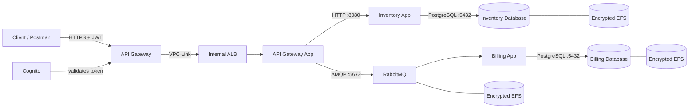

# Cloud Design

AWS deployment of the movie inventory and asynchronous billing platform built
in the previous CRUD Master, Play With Containers, and Orchestrator projects.

The repository contains all six container services and the complete Terraform
configuration used to run them on AWS.

## Local prerequisites

- Docker
- Terraform
- AWS CLI v2.32 or newer (required for temporary `aws login` credentials)

Cloud credentials, Terraform state, `.tfvars`, and application secrets must
never be committed.

## Configuration and deployment

The bootstrap configuration creates a minimal console user and a project
operator role. Root is used only to create or repair this IAM bootstrap; normal
Terraform and audit commands use temporary assumed-role credentials:

```bash
aws login --profile cloud-design-login --region eu-central-1
aws configure set source_profile cloud-design-login \
  --profile cloud-design-operator
aws configure set credential_process \
  'aws configure export-credentials --profile cloud-design-operator --format process' \
  --profile cloud-design-terraform
aws configure set region eu-central-1 --profile cloud-design-terraform

export AWS_PROFILE=cloud-design-terraform
export AWS_REGION=eu-central-1
aws sts get-caller-identity
```

The resulting ARN must contain `assumed-role/cloud-design-operator`, never
`:root`. The login user has no access keys and can only authenticate locally
and assume this role. The role is region-limited, can access only the project
state bucket, and can manage IAM roles/profiles only under `cloud-design-*`.

1. Create the remote-state bucket from `terraform/bootstrap`, copy
   `terraform/backend.tf.example` to `terraform/backend.tf`, and replace the
   bucket placeholder with the `state_bucket_name` output.
2. Initialize the root configuration and create its compute foundation first.
   This targeted bootstrap supplies the ECR repositories and empty Secrets
   Manager containers before any application task tries to use them:

   ```bash
   terraform -chdir=terraform init
   terraform -chdir=terraform apply -target=module.compute_foundation
   ```
3. Copy `.env.secrets.example` to `.env.secrets`, replace every
   `change-me`, and populate Secrets Manager without placing credentials in
   Terraform state:

   ```bash
   scripts/put-secret-value.sh --name-prefix cloud-design-dev
   ```

4. Publish the six images with an immutable version tag, then apply that same
   tag to the infrastructure:

   ```bash
   TAG=$(git rev-parse --short HEAD)
   ACCOUNT_ID=$(aws sts get-caller-identity --query Account --output text)
   scripts/publish-images.sh --account-id "$ACCOUNT_ID" --tag "$TAG"
   terraform -chdir=terraform plan -var="image_tag=$TAG" -out=tfplan
   terraform -chdir=terraform apply tfplan
   ```

5. Confirm that Terraform and the six ECS services are stable. Read the
   deployed tag from Terraform state rather than assuming the current
   documentation commit was used to build the images:

   ```bash
   DEPLOYED_TAG=$(terraform -chdir=terraform output -raw deployed_image_tag)
   terraform -chdir=terraform plan -var="image_tag=$DEPLOYED_TAG"
   aws ecs describe-services --cluster cloud-design-dev-cluster \
     --services api-gateway-app inventory-app inventory-database \
       billing-app billing-database rabbit-queue \
     --query 'services[].{service:serviceName,desired:desiredCount,running:runningCount,pending:pendingCount}'
   ```

The first command should report `No changes`; every service should have its
desired and running counts equal, with zero pending tasks.

## Architecture



Only API Gateway is public. The ALB, ECS tasks, databases, RabbitMQ, EFS mount
targets, and EC2 capacity remain inside the VPC.

### Compute foundation (`terraform/modules/compute-foundation`)

- ECS cluster on the **EC2 launch type**, not Fargate: an Auto Scaling
  Group of Free Tier eligible `m7i-flex.large` instances behind an ECS capacity
  provider with managed scaling and managed termination protection.
  Cheaper per compute-hour than Fargate; the cost is owning AMI updates
  (resolved via the SSM `amazon-linux-2023` ECS-optimized AMI parameter,
  not pinned by hand) and capacity planning ourselves.
- Instances have **no SSH**: no key pair, no port 22 security group rule,
  no public IP. Operator access is via AWS Systems Manager Session
  Manager only (`AmazonSSMManagedInstanceCore` on the instance role).
- ECR repository per service, for all six: `api-gateway-app`,
  `inventory-app`, `inventory-database`, `rabbit-queue`, `billing-app`,
  `billing-database` — one shared cluster, one shared set of repos for
  both developers' workloads. Vulnerability scan-on-push enabled,
  immutable tags, `force_delete = true` (so a repo that still has images
  in it doesn't block a full `terraform destroy`).
- ECR scans every pushed image for known vulnerabilities. Amazon Inspector
  EC2/ECR scanning is also defined in Terraform and can be enabled with
  `enable_inspector = true`; it defaults off because AWS Free plan accounts
  can reject the required Inspector subscription.
  The audit image scan completed on 2026-09-27. Its critical Debian 12
  findings currently report no fixed package version (including Perl/OpenSSL,
  and Erlang/RabbitMQ in `rabbit-queue`), so they remain a visible remediation
  backlog: rebuild and redeploy the immutable images as soon as Debian
  publishes fixed packages rather than suppressing the findings.
- A shared ECS task execution role (ECR pull, CloudWatch Logs, and scoped
  Secrets Manager reads — see Secrets below) and one empty per-service
  task role each, all six, ready to gain further least-privilege
  permissions as a service actually needs another AWS API.
- Three Secrets Manager secret *containers* (metadata only — see Secrets
  below) for billing-database, RabbitMQ, and inventory-database.
- A private DNS namespace (`cloud-design.internal`) for internal service
  discovery, shared by every service that registers with it.
- Outbound network path for the ECS instances (ECR pulls, CloudWatch Logs,
  SSM since there's no SSH) is Developer A's NAT Gateway, built on their
  `feat/edge-inventory` branch (`enable_nat_gateway = true` by default) —
  confirmed by reading their actual `network` module rather than assumed;
  this was flagged as an open blocker earlier and is now resolved.

### Billing workloads (`terraform/modules/billing-workloads`)

Three ECS services, all `awsvpc` network mode, private subnets only, no
public IP:

- **`rabbit-queue`** — persistent storage is EFS (encrypted), not an
  instance-local volume, so data survives the Auto Scaling Group replacing
  the underlying EC2 instance, not just the task. A non-essential sidecar
  container in the same task (`rabbit-queue-bootstrap`) provisions the
  application user via the RabbitMQ Management HTTP API, since the custom
  image has no equivalent of the official image's
  `RABBITMQ_DEFAULT_USER`/`PASS`. It authenticates as `guest`, which
  RabbitMQ restricts to loopback by default — safe here specifically
  because "loopback" means "inside this same ECS task" in `awsvpc` mode,
  not reachable from anywhere else.

  The task pins `RABBITMQ_NODENAME=rabbit@localhost`. **This was a real bug
  found by testing, not a guess**: without it, RabbitMQ derives its node
  name from the container's hostname, which is random per task. Replacing
  the task then leaves the new one unable to find the old node's Mnesia
  directory, so it silently boots an *empty* database — confirmed locally,
  where the bootstrap user and a durable queue both vanished after a
  container swap. Re-tested after the fix: user, queue, and message all
  survived a full container replacement.

- **`billing-database`** — same EFS-backed persistence pattern, verified
  independently (no RabbitMQ-style node-identity issue here, but confirmed
  rather than assumed after getting burned once). AWS Backup's automatic
  EFS backups are enabled for this file system specifically (not
  `rabbit-queue`'s — queue contents are transient in-flight data, not
  something with a "backup and restore" story).

- **`billing-app`** — stateless consumer, connects to the other two by
  internal DNS, exposes port 8080 for health checks only (billing orders
  arrive exclusively via RabbitMQ, never HTTP).

Security groups are scoped per service (`billing-database` only reachable
from `billing-app`'s security group, `rabbit-queue` only from `billing-app`
plus whatever Developer A's `api-gateway-app` task security group gets
added at integration time), not just placed in a shared private subnet.

**Secrets**: usernames and passwords for `billing-database`,
`inventory-database`, and RabbitMQ (shared with Developer A's
`api-gateway-app`, which authenticates as the same account to publish to
the same queue) live in AWS Secrets Manager, not Terraform. `compute-foundation` creates only the empty secret *containers*
(`aws_secretsmanager_secret`, no `aws_secretsmanager_secret_version`) —
real values are never written by Terraform, because even a value that never
appears in `.tf` source would still land in Terraform state the moment a
resource set it. Real values are populated separately, out-of-band, by
`scripts/put-secret-value.sh`, which reads a git-ignored local file (see
`.env.secrets.example`) and calls `aws secretsmanager put-secret-value`
directly — it must run once before the first task launch, since the ECS
task execution role fetches these values at container start via each task
definition's `secrets` block, and a task pointed at an empty secret won't
start.

### Billing observability (`terraform/modules/billing-workloads/observability.tf`)

- CloudWatch log group per container (4 total), 14-day retention, referenced
  directly by each task definition rather than relying on log-group
  auto-creation.
- Alarms, all publishing to one SNS topic: running-task-count and CPU for
  `billing-app` and `rabbit-queue`, plus a log-metric-filter-based
  error-rate alarm for `billing-app` (RabbitMQ's Erlang log format was
  judged too noisy for reliable pattern matching, so `rabbit-queue` relies
  on the running-task-count alarm as its health signal instead).
  `billing-database` gets a CPU alarm only — no storage alarm, since EFS
  scales storage automatically and has no "disk full" failure mode.
- One small CloudWatch dashboard (CPU, running tasks, error count).
- Backup/restore for billing data was **actually run**, not just declared:
  seeded rows into a local instance of `billing-database`, `pg_dump`'d,
  copied the dump out of the container (off-instance, as a real backup must
  be), `DROP TABLE`'d the data to genuinely destroy it, restored from the
  copied-out dump, and confirmed every row came back with the exact
  original values.

### Inventory workloads (`terraform/modules/inventory-workloads`)

Two ECS services, same `awsvpc`/private-subnet/no-public-IP pattern as
billing. One real interface difference from billing: this module does
**not** create its own security groups for `inventory-app` /
`inventory-database` — it takes Developer A's `security` module's SG IDs
as inputs instead, since that module already models both workloads and
the gateway→inventory→database traffic path. It still owns one small
security group of its own for the EFS mount targets, since Developer A's
`security` module has no NFS/EFS concept.

- **`inventory-database`** — backed by its own encrypted EFS filesystem,
  mounted directly with encryption in transit like `billing-database`.
- **`inventory-app`** — connects to `inventory-database` by internal DNS.
  **Has no dedicated health endpoint** (confirmed by reading
  `app/__init__.py` and `app/routes/movies.py` directly — no `health.py`,
  no `/healthz`, unlike `billing-app` and `api-gateway-app`), so its ECS
  health check uses `GET /api/movies` instead: it fails unless the app is
  up *and* its database connection actually works. Also gets **ECS
  Application Auto Scaling on CPU** (target-tracking, 60% target, min
  1/max 4) — the one service in this codebase that scales with load,
  since it's stateless and CRUD-heavy rather than architecturally capped
  at one writer.
- Observability mirrors the billing pattern (SNS topic, CPU + running-task
  alarms, a small dashboard), deliberately without a log-based error-rate
  alarm: `inventory-app`'s routes return 400/404 as ordinary JSON for
  client validation failures, never at `ERROR` log level, so that alarm
  would just sit at zero.

### Availability, stated plainly

- `rabbit-queue`, `billing-database`, and `inventory-database` are all
  single-instance (`desired_count = 1`). All three *recover* after task
  replacement thanks to EFS-backed storage — proven locally for the
  billing side, including the node-identity bug above — but none is
  highly available: there is downtime during replacement, no clustering,
  no quorum, no failover. Do not read the recovery evidence above as an
  HA claim.
- `billing-app` and `inventory-app` are the two stateless services here.
  RabbitMQ's competing-consumers pattern makes it safe to run more than
  one `billing-app` instance against the same queue, so its
  `desired_count` could be raised for real availability/throughput
  headroom — left at 1 for now pending budget, unlike `inventory-app`,
  which already scales automatically on CPU since it has no equivalent
  single-writer constraint to reason about first.

### Security boundaries and accepted trade-offs

- Public requests use the AWS API Gateway HTTPS endpoint and require a Cognito
  JWT. Anonymous requests are rejected with `401`.
- ECS tasks have no public IP. Security groups allow only the required
  gateway→inventory, inventory→database, gateway→RabbitMQ, and
  billing→database paths.
- Runtime credentials live in Secrets Manager and are injected into task
  definitions. No secret value is stored in Git or Terraform state.
- EFS and the Terraform state bucket are encrypted at rest; EFS mounts and
  state access require encrypted transport.
- Internal application HTTP, AMQP, and PostgreSQL traffic is isolated inside
  the VPC and authenticated where supported, but is not end-to-end TLS. A
  production hardening iteration would enable PostgreSQL/RabbitMQ TLS and an
  HTTPS internal listener or service mesh.
- Application and database services currently start as one task. ECS replaces
  failed tasks and EFS preserves their data, but the stateful services are not
  clustered and have a short recovery window rather than zero-downtime HA.
- ECR scans every immutable image on push. Known Debian findings without a
  published fixed package remain visible; images must be rebuilt when fixes
  become available rather than suppressing the findings.

## Monitoring and logging

All application output is sent to CloudWatch Logs with 14-day retention.
Container Insights, three dashboards, and twelve alarms cover CPU, running
task count, API 5xx responses, unhealthy ALB targets, and billing errors.
Optional email subscriptions use SNS.

Useful audit commands:

```bash
aws cloudwatch list-dashboards \
  --dashboard-name-prefix cloud-design-dev
aws cloudwatch describe-alarms \
  --alarm-name-prefix cloud-design-dev \
  --query 'MetricAlarms[].{name:AlarmName,state:StateValue}'
aws logs tail /ecs/cloud-design-dev/api-gateway-app \
  --since 15m --format short
aws logs tail /ecs/cloud-design-dev/billing-app \
  --since 15m --format short
```

## Scaling validation

`api-gateway-app` scales from 1–3 tasks and `inventory-app` from 1–4 tasks,
both at a 60% CPU target. The ECS capacity provider scales its EC2 Auto
Scaling Group from 1–3 instances when tasks need additional capacity.

The audit load test runs from a temporary ECS task carrying the gateway
security group, so it exercises the real private service path without opening
the inventory service publicly. During and after the test, record desired and
running task counts plus the `CPUUtilization` CloudWatch metric. The temporary
task exits by itself and stores no data.

On 2026-09-28 this test triggered the target-tracking alarm successfully. ECS
first changed `inventory-app` from one to two desired tasks and then from two
to the configured maximum of four. The service stabilized at
`desired=4, running=4, pending=0`; the temporary load task was then stopped and
the target-tracking policy was left to return the service toward its minimum
after its low-CPU evaluation and 120-second scale-in cooldown.

## Cost management

The main recurring costs are the NAT Gateway, internal ALB, ECS EC2 capacity,
EFS, and CloudWatch. One shared ECS cluster, small initial replica counts,
14-day log retention, automatic EFS sizing, and short audit windows limit the
cost. AWS Budgets must remain enabled and Cost Explorer should be checked
before and after load testing. On 2026-09-28, Cost Explorer reported about
`$0.052` of unblended service cost for the month; free-plan credits may hide
additional list-price usage, so this is evidence, not a future cost guarantee.

```bash
aws ce get-cost-and-usage \
  --time-period Start=2026-09-01,End=2026-09-29 \
  --granularity MONTHLY --metrics UnblendedCost
```

### Failure-scenario evidence

Verified end-to-end locally (Docker network, all four images including
Developer A's unmodified `api-gateway-app`, no AWS required to prove the
application-level contract):

1. Stopped `billing-app`, `POST`ed an order to `api-gateway-app`'s
   `/api/billing` — got `200 OK`, `{"message":"Message posted"}`, and
   confirmed the message was actually sitting in the queue
   (`"messages":1`), not silently dropped.
2. Started `billing-app` — it processed the order within seconds
   (`Processed billing order 1` in its logs).
3. Queried `billing-database` directly: the row was present with the exact
   values from the original request (`user_id=42`, `number_of_items=3`,
   `total_amount=59.97`), and the queue was back to `"messages":0` —
   consumed exactly once, no duplication.

This used the same credentials and queue name
(`billing_service`/`billing_queue`) the Terraform modules use in AWS, so
the only thing that changes at real deployment is the transport (Docker
bridge network → private VPC + service discovery), not the contract being
proven here.

## Audit usage

Use the non-root operator profile throughout the audit:

```bash
export AWS_PROFILE=cloud-design-terraform
export AWS_REGION=eu-central-1
aws sts get-caller-identity
```

API Gateway rejects anonymous requests. Create/reset an audit user and obtain
a one-hour Cognito ID token without saving its password in the repository:

```bash
TOKEN=$(scripts/cognito-token.sh audit@example.com)
API=$(terraform -chdir=terraform output -raw api_endpoint)
curl -i -H "Authorization: Bearer $TOKEN" "$API/api/movies/"
```

Use the same `Authorization` header in Postman. The main functional checks are:

```bash
curl -i -X POST "$API/api/movies/" \
  -H "Authorization: Bearer $TOKEN" \
  -H 'Content-Type: application/json' \
  -d '{"title":"A new movie","description":"Very short description"}'

curl -i -X POST "$API/api/billing/" \
  -H "Authorization: Bearer $TOKEN" \
  -H 'Content-Type: application/json' \
  -d '{"user_id":"20","number_of_items":"99","total_amount":"250"}'
```

To demonstrate asynchronous resilience, set `billing-app` to zero tasks,
repeat the billing request with `user_id=22`, and restore it. The request still
returns `200`; RabbitMQ retains it and the restarted consumer writes it to
PostgreSQL:

```bash
aws ecs update-service --cluster cloud-design-dev-cluster \
  --service billing-app --desired-count 0
aws ecs wait services-stable --cluster cloud-design-dev-cluster \
  --services billing-app
# Send the user_id=22 request here.
aws ecs update-service --cluster cloud-design-dev-cluster \
  --service billing-app --desired-count 1
aws ecs wait services-stable --cluster cloud-design-dev-cluster \
  --services billing-app
```

CloudWatch log groups, dashboards, alarms, and ECS service metrics provide the
runtime evidence for troubleshooting and scaling. EC2 nodes have no SSH or
public IP; operational access uses Systems Manager Session Manager.

## Cleanup

Destroy roughly in reverse of apply:

1. **`billing-workloads`** and **`inventory-workloads`** first (either
   order — they don't depend on each other) — ECS services/tasks, EFS
   filesystems, security groups (billing's own; inventory-workloads'
   single EFS mount-target one), service discovery entries, CloudWatch log
   groups/alarms/dashboards, SNS topics.
2. **`compute-foundation`** next — ECS cluster, the Auto Scaling Group
   (terminates the EC2 instances), launch template, capacity provider, ECR
   repositories, and the three Secrets Manager containers
   (`recovery_window_in_days = 0`, so these delete immediately rather than
   entering a recovery window). ECR repos have `force_delete = true`
   specifically so a repo that still has images in it doesn't stop
   `destroy` partway through — without it, a non-empty repo fails and
   needs the images deleted manually before retrying.
3. **`bootstrap`** (the state bucket) last, and only when genuinely done
   with the whole exercise, not between ordinary work sessions — every
   other config depends on it for remote state once integration happens.

Known leftovers to check for even after `destroy` reports success:

- **AWS Backup recovery points** for billing-database's EFS filesystem —
  destroying the source file system does not delete existing backups; they
  keep costing (small amounts of) money until removed from the vault
  separately.
- **The state bucket's old object versions** — versioning is deliberately
  on and `force_destroy` deliberately isn't set on the bucket itself, so
  deleting it at the very end requires emptying all versions first. That's
  intentional friction against an accidental one-command wipe of shared
  state history, not an oversight.
- **CloudWatch Logs** should self-expire per each log group's
  `retention_in_days`, but worth a spot-check rather than assuming.
